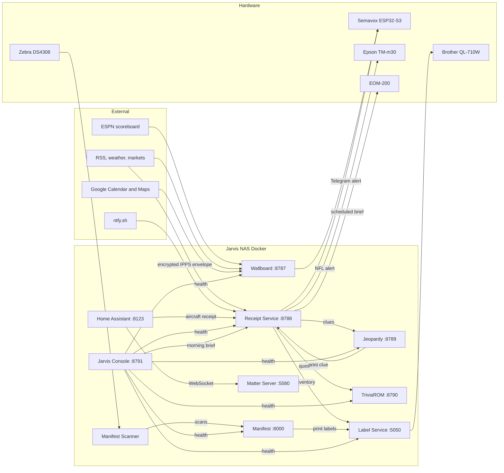

# Jarvis ecosystem map

Audited on 2026-11-05 by static inspection of source and configuration. **No container,
DNS record, proxy rule or device was queried**, so "deployed" here means "deployment is
defined in this directory", not "confirmed running". Agents should begin with
[START_HERE.md](START_HERE.md) and [AGENT_OPERATIONS.md](AGENT_OPERATIONS.md). The older [SERVICE_CATALOG.md](SERVICE_CATALOG.md) dates
from 2026-10-22 and has known stale rows, listed in [AUDIT_REPORT.md](AUDIT_REPORT.md).

## Architecture

Solid lines are integrations present in source. All of them are unauthenticated HTTP on the trusted LAN unless labeled.

## Service catalog

"Git" gives the `github.com/e-rnest` repository, or "none" for a directory with no version control.

| Name | Purpose | Path (under `docker/`) | Git | Status | URL or port | Depends on | Docs |
| --- | --- | --- | --- | --- | --- | --- | --- |
| Jarvis Console | Status dashboard and ecosystem docs | `jarvis-console` | `jarvis-console` | Production | `console.jarvis.home`, `:8791` | Status targets, Receipt history volume | [README](README.md) |
| Wallboard | Household display, NFL events | `wallboard` | none | Production | `wallboard.home`, `:8787` | Google, ESPN, feeds, `wallboard-private`, Semavox | [README](../wallboard/README.md) |
| Receipt Service | Thermal printing, Morning Brief, Telegram | `receipt-service` | `receipt-service` | Production | `jarvis.home:8788` | Printers, Label, Jeopardy, TriviaROM, ntfy, Semavox | [README](../receipt-service/README.md) |
| Label Service | Label printing, food inventory | `label-service` | `label-service` | Production | `label.jarvis.home`, `:5050` | Brother printer | [README](../label-service/README.md) |
| Manifest | Barcode inventory, nutrition | `manifest-service` | `manifest-service` | Production | `manifest.home`, `:8000` | Label Service, local catalog | [README](../manifest-service/README.md) |
| Manifest Scanner | Durable scan capture and delivery | `manifest-scanner` | `manifest-scanner` | Production | No listener | Zebra scanner, Manifest | [README](../manifest-scanner/README.md) |
| Jarvis Scanner | Older, log-only scanner | `jarvis-scanner` | none | Legacy; running state unknown | No listener, no network | Zebra scanner | [README](../jarvis-scanner/README.md) |
| Jeopardy | Clue browser and API | `jeopardy-service` | `jeopardy-service` | Production | `jeopardy.home`, `:8789` | Receipt for printing | [README](../jeopardy-service/README.md) |
| TriviaROM | Arcade trivia browser and API | `triviaROM-service` | `triviaROM-service` | Production | `trivia.jarvis.home`, `:8790` | Bundled corpus | [README](../triviaROM-service/README.md) |
| Home Assistant | Automation | `homeassistant` | none | Production | `ha.jarvis.home`, `:8123` | Matter Server, Receipt | [README](../homeassistant/README.md) |
| Matter Server | Matter fabric | `matterjs-server` | `matterjs-server` | Production | `:5580`, same host | None | [README](../matterjs-server/README.md) |
| BlackTorrent | qBittorrent behind Gluetun VPN | `blacktorrent` | `blacktorrent` | Production | `blacktorrent.home`, `:8080` | NordVPN | [README](../blacktorrent/README.md) |
| Jellyfin | Media server | `jellyfin` | none | Production; no Compose file here | `jellyfin.home`, `:8096` | Unknown from this directory | [README](../jellyfin/README.md) |
| Scrypted | Camera and device bridge | `scrypted` | none | Defined; canonical URL unknown | Host network | None verified | [README](../scrypted/README.md) |
| Semavox | LED matrix and audio device | Outside share (see below) | `semavox` | Hardware; flashed version unknown | `semavox.home`, `192.168.1.80` | LAN | External README and `API.md` |

### Supporting directories (not services)

| Path | What it is |
| --- | --- |
| `wallboard-private` | Wallboard secrets, local config and runtime state, bind-mounted. Never copy or print it. |
| `backups` | Dated pre-deploy and state copies. Not live code. |
| `manifest-acceptance-runs` | Output from isolated Manifest acceptance runs in November 2026. No README or code reference found. |
| `manifest-food-database-raw` | Raw Open Facts and USDA data, apparently the source for Manifest's catalog. The link is inferred from content. |
| `Jarvis Service URL and API Inventory.md` | Stale inventory from 2026-10-01. Use this page instead. |

Semavox is at `~/Library/Mobile Documents/com~apple~CloudDocs/¶ PROJECTS/¶ CODE/Arduino/semavox`.
This audit did not change it. The related private art source `e-rnest/small-worlds` supplies scene artwork.

## Operational map

**Docker on Jarvis:** every catalog row except Semavox. Jellyfin's container definition is not on this share.

**Directly on hardware:** Semavox firmware, the three printers and the Zebra scanner.

**External and not in any repository here:** UCG-Fiber local DNS, and Synology DSM reverse proxy rules.
Friendly names in this document come from configuration and were not resolved.

**Shared infrastructure**

| Resource | Owner | Used by | Warning |
| --- | --- | --- | --- |
| Network `jarvis-receipt-services` (external) | Shared | Receipt, Jeopardy, TriviaROM, Console | Must exist before these start |
| Volume `morning-brief_schedule-data` (external) | Receipt | Console mounts it read-only | Holds the scheduler ledger and private Telegram history |
| `/dev/input` scanner device | Manifest Scanner | Also readable by Jarvis Scanner | Confirm which container should own it before starting both |
| Printers on port 9100 | Receipt and Label | Every print path | HTTP success does not prove paper output |

**Source versus deployed:** Wallboard, Label and the others build from these directories on
the NAS. Label bind-mounts `.:/app`, so its source edits can reach the running container
sooner than those of image-based services. Check `compose.yaml` before assuming either behavior.

**No notification hub exists.** A search of the service source and the Semavox firmware found
no hub or event router. Wallboard and Receipt each call Semavox directly. Treat any hub as a proposal.
